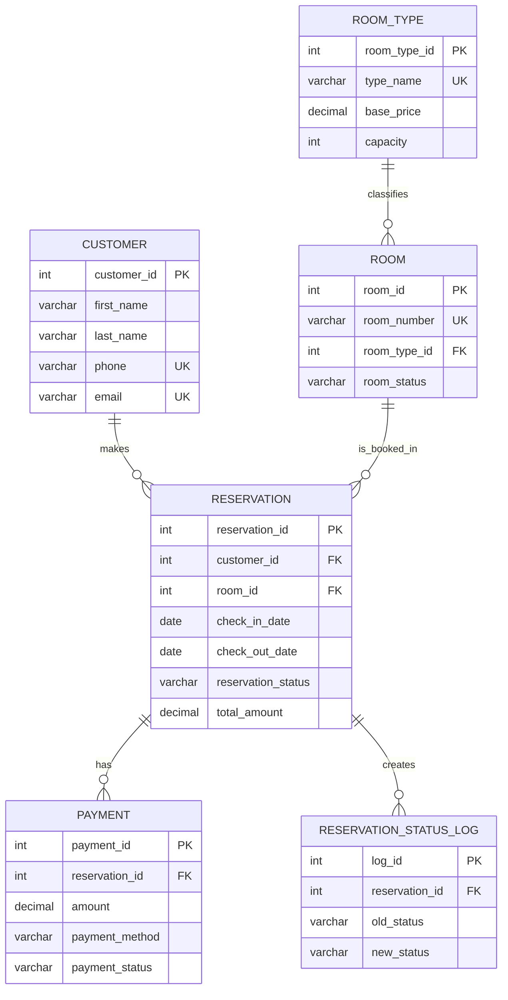

# ER Diagram and Relational Schema

Paste the Mermaid block into https://mermaid.live or recreate it in draw.io for your report.



## Relational schema

```text
CUSTOMER(customer_id PK, first_name, last_name, phone UNIQUE, email UNIQUE, address, created_at)
ROOM_TYPE(room_type_id PK, type_name UNIQUE, base_price, capacity, description)
ROOM(room_id PK, room_number UNIQUE, room_type_id FK, floor_no, room_status)
RESERVATION(reservation_id PK, customer_id FK, room_id FK, check_in_date,
            check_out_date, adults, children, reservation_status, booking_date,
            total_amount, remarks)
PAYMENT(payment_id PK, reservation_id FK, payment_date, amount,
        payment_method, payment_status, transaction_reference UNIQUE)
RESERVATION_STATUS_LOG(log_id PK, reservation_id FK, old_status, new_status,
                       changed_at, changed_by)
```

## Why this is in 3NF

- **1NF:** every column has a single value; there are no repeating groups.
- **2NF:** each non-key column depends on the complete primary key.
- **3NF:** room-type price/capacity are kept in `room_type`, customer data is kept in `customer`, and payment data is kept in `payment`; therefore, non-key columns do not depend on other non-key columns in the same table.
